<p align="center">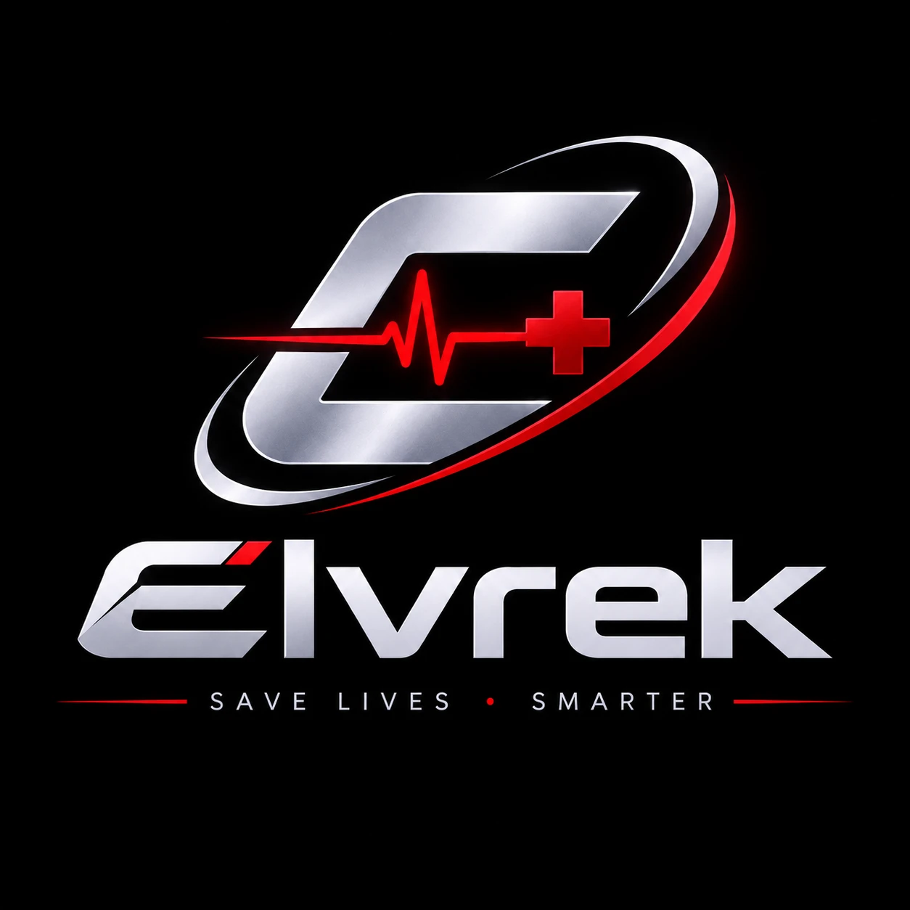</p>

# Elvrek

**A steady arm when every second counts.**

Elvrek is the safety controller for a chest compression robot, built on QNX 8.0. One real-time process owns the piston, the timing of every breath, the defibrillator charger and the shock line, all on a clock that ticks a thousand times a second. The AI rhythm classifier can only make suggestions, and QNX refuses it everything else. If the safety process itself dies, the motor driver lifts the cup off the chest on its own.

[**Live site: elvrek.vercel.app**](https://elvrek.vercel.app) · [**Demo video (2:41)**](https://youtu.be/lBU1zjZX8Ok) · [Submission](SUBMISSION.md) · [QNX integration](QNX.md) · [Results review](RESULTS.md) · [Safety rules](SAFETY.md)

[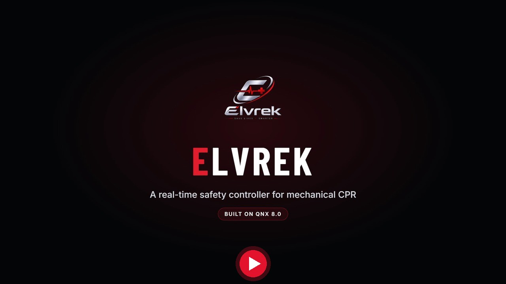](https://youtu.be/lBU1zjZX8Ok)

*Watch the 2:41 demo on YouTube. Every QNX clip is real output recorded on QNX 8.0 in QEMU, labelled with its playback speed. How it was made is in [video/README.md](video/README.md).*

Built for the **QNX Global Hackathon**, Robotics and Medical category.

> **Please read this first.** Elvrek is a research controller. It is not a medical device and must never be connected to a person. In this repository the piston and the chest are a physics model behind the same interface a real motor driver will use. No shock is ever delivered; on a bench the shock line drives a lamp.

## At a glance

| | |
|---|---|
| **Platform** | QNX 8.0 (SDP 8.0), x86_64 in QEMU with KVM, 2 virtual CPUs. The same code builds for aarch64le, ready for a Raspberry Pi 5 |
| **Toolchain** | qcc (gcc_ntox86_64), image made with mkqnximage, started by System Launch and Monitor |
| **Control loop** | 1 ms timer pulse on a private channel, SCHED_FIFO priority 60, missed ticks measured with `ClockCycles` |
| **On QNX 8.0** | **12 of 12** fault cases pass with the rhythm read through compressions, two full runs in a row ([raw output](docs/results/)) |
| **Reads the rhythm through compressions** | The controller cancels its own compression artifact using the piston phase it commands, so most rhythm checks need no pause at all. On real arrest ECG (VFDB, 0 dB): VF shocked 82.1% against 75.0% for always pausing, and wrong shock advice falls by two thirds ([details](docs/ZERO-PAUSE.md)) |
| **Shock window** | 4 ticks of machine time on QNX when the rhythm was read through the compressions; 803 ticks (park, 0.8 s look, discharge) when it was not sure. The crew's time is counted separately |
| **AI fence** | An enforced QNX security policy: the classifier's only door is a separate advice gate. 7 of 7 forbidden actions refused; kept as root under its type, the kernel still refuses every path to the piston and shock line ([A/B](docs/results/qnx-secpol-attack-ab.txt)) |
| **Hard limits** | The controller stops pushing at 600 N and 650 N is never crossed. Depth 5 to 6 cm, full recoil every stroke |
| **Kernel trace** | QNX `tracelogger`: control work per tick median 27 to 37 µs, 0 ticks past 1 ms; under a priority 59 CPU storm the controller preempts it within 42 µs ([docs/TIMING.md](docs/TIMING.md)) |
| **Host tests** | **22 of 22** scenarios with 0 rule violations, run on every push by GitHub Actions |
| **Real ECG** | 57 PhysioNet arrest records. Held out: VF found 75.0%, normal sinus left alone 97.7%. Still short of clinical goals, and we say so |
| **Website** | 12 pages: landing, system, technology, evidence, recorded run, FAQ and more, on desktop and phone |

## Contents

- [The idea in one minute](#the-idea-in-one-minute)
- [Results on QNX 8.0](#results-on-qnx-80)
- [Why Elvrek](#why-elvrek)
- [Product tour](#product-tour)
- [How it works](#how-it-works)
- [Architecture](#architecture)
- [What the controller guarantees](#what-the-controller-guarantees)
- [Verification](#verification)
- [Build log](#build-log)
- [Quickstart](#quickstart)
- [Repository layout](#repository-layout)
- [Documentation](#documentation)
- [Risks and limits](#risks-and-limits)
- [Data and licence](#data-and-licence)

## The idea in one minute

When a heart stops, every pause in chest compressions costs something, and the pause before a shock costs the most. In a study of 815 out-of-hospital arrests, every extra five seconds of that pause came with about 18% lower odds of survival (Cheskes et al., Circulation, 2011). Mechanical CPR devices never get tired, but the compressions, the breaths and the defibrillator usually keep separate clocks and a person coordinates them.

Elvrek puts all three on one clock. The charger fills while the piston keeps working, the arm parks at full recoil only for the shock itself, a trusted check confirms the rhythm on clean ECG, and compressions resume on the next tick.

QNX is what makes the split between "may decide" and "may only suggest" real:

| QNX feature | In Elvrek |
|---|---|
| Timer pulse on a private channel (`timer_create`, `MsgReceivePulse`) | The **1 ms heartbeat** that wakes the safety process |
| `SCHED_FIFO` priorities | The safety process at 60 sits above everything except the hardware stand-in; the classifier runs at 10 |
| `ClockPeriod`, `ClockCycles` | The safety process reads the system tick it runs on and measures every late or missed tick |
| Resource managers (`resmgr_attach`) | `/dev/elvrek/status`, `advice`, `operator`, `piston` and `shock`: the only doors to the hardware |
| `procmgr_ability` and an unprivileged user | The classifier **cannot climb back**: no root, no priority raise, no hardware memory |
| Security policy (`secpolgenerate`, `secpolcompile`, `--secpol=secure`) | Every process under its own type; the classifier may connect to the advice gate and nothing else, enforced by the kernel ([qnx/secpol](qnx/secpol/README.md)) |
| `secpol_posix_spawnattr_settypeid` | The supervisor spawns the classifier straight into its own type |
| System Launch and Monitor | Starts the stack in order and marks the safety process `repair none` |
| `slog2` | The event log of every state change and fault |

## Results on QNX 8.0

The whole stack, built with qcc, running on QNX 8.0 in QEMU. Two full runs in a row with the final code, which reads the rhythm through the compressions, in the stack's labelled emulator mode (sensor timeout 50 ms and hardware watchdog 100 ms, because a virtual machine on a laptop pauses for tens of milliseconds).

| Case | What it does | Result |
|---|---|---|
| T1 Control loop | Counts ticks in one second | 960 to 1,013 ticks a second on the default 1 ms tick |
| T2 Compressions | Ten seconds of compressions | 16 to 17, 0 rule violations |
| T3 Advisor attack | The classifier tries 7 forbidden actions | **7 of 7 refused by QNX** |
| T4 Advisor killed | Kill the classifier mid compression | Compressions continue, the supervisor restarts it |
| T5 CPU storm | 8 threads at priority 59 for 10 s | Compressions keep their rate, every stroke 5 to 6 cm, 0 violations |
| T6 Stiff chest | The chest turns very stiff | Peak 604 N, under the 650 N hard limit |
| T7 Transport | A moving ambulance frame | Depth in range on 100% of strokes, peaks 51 to 54 mm |
| T8 Sensor dropout | The hardware goes silent | Controlled retract, safe hold |
| T9 Safety process killed | `slay elvrekd` mid stroke | The driver watchdog lifts the cup to 0.0 mm; nothing restarts the controller |
| T10 Shock and return | A full shockable rhythm run | Rhythm read as shockable through the compressions, so one shock with **3 ticks** of hands-off (803 when the old design paused to look), 0 shocks off recoil, return of circulation detected, CCF 100% |
| T11 Malicious advisor | Hundreds of forged demands | All ignored, the shock still delivered, 0 violations |
| T12 Read through compressions | Asystole, no advice, to the 2-minute check | Read as sure not shockable (scores 0.08 and 0.12), so **no pause at all** and no shock. When the reading is not sure, the 0.8 s look runs instead |

Raw output: [`docs/results/qnx-fault-suite-zero-pause-1.txt`](docs/results/qnx-fault-suite-zero-pause-1.txt) and [`-2.txt`](docs/results/qnx-fault-suite-zero-pause-2.txt). The earlier design, which always paused 0.8 s to look, passed 11 of 11 three runs in a row ([`all-pass-3`](docs/results/qnx-fault-suite-all-pass-3.txt), [`-4`](docs/results/qnx-fault-suite-all-pass-4.txt), [`-5`](docs/results/qnx-fault-suite-all-pass-5.txt)). These runs use two idle threads at the lowest priority to keep QEMU's virtual CPUs awake (labelled in the output). Every earlier run, including the failed ones, is in [`docs/results/earlier/`](docs/results/earlier/), and [RESULTS.md](RESULTS.md) explains what each failure taught us.

**At real hardware timings** (5 ms sensor timeout, 20 ms watchdog) the nested virtual machine is the limit: QEMU runs inside WSL2, which is itself a virtual machine on Windows. The first strict run passed 5 of 11, and every failure was the controller correctly calling the sensors silent and retracting. With two idle threads at the lowest priority keeping the virtual CPUs awake, **9 of 11** pass, including the full shock. Real hardware is what settles this.

## Why Elvrek

| | |
|---|---|
| **The robot cancels its own noise** | Every defibrillator stops compressions to read the heart, because compressions bury the ECG. Elvrek is the machine pushing, so it knows the phase of every stroke to the millisecond and subtracts its own artifact. Sure readings need no pause; unsure ones fall back to a 0.8 s look. No other entry owns the actuator, so no other entry can do this ([docs/ZERO-PAUSE.md](docs/ZERO-PAUSE.md)) |
| **What's new** | A machine that closes a force loop on a body on a 1 ms deadline, and owns the whole resuscitation clock: compressions, breaths, charge, shock, return of circulation and the drug timer. The only hands-off time left is the shock itself, and the machine's part of it is 0.8 s |
| **Built on QNX** | Timer pulses, priorities, resource managers, abilities, an unprivileged classifier, a supervisor that never restarts the safety process, System Launch and Monitor, slog2, qcc and mkqnximage. All of it is exercised by an on-target fault suite ([QNX.md](QNX.md)) |
| **Robotics where it counts** | Force control with a ceiling, adaptive depth for a stiff chest, chest motion correction in transport, a controlled retract that never stops at the bottom of a stroke, and a driver watchdog that works even when the software is dead |
| **Honest by design** | Every number in this repository comes from a run you can repeat, and every failed run is published. The weak spots (the rhythm check on real ECG, strict timing in a nested VM) are stated plainly |

## Product tour

| | |
|---|---|
| 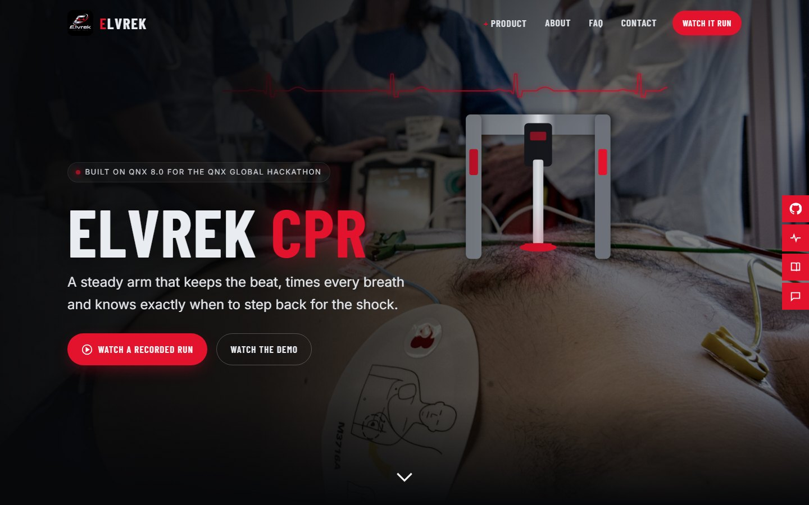 | **Landing.** The arm pressing on a patient's chest, and the case for one clock |
| 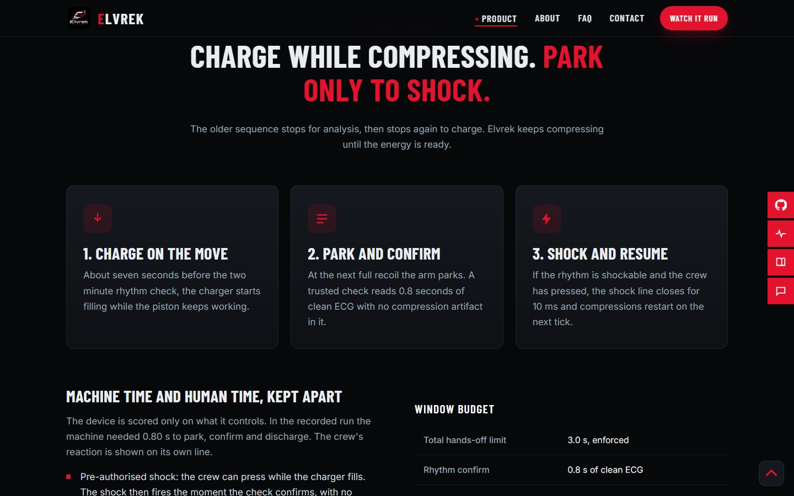 | **The system.** Charge while compressing, park only to shock, machine time and human time kept apart |
| 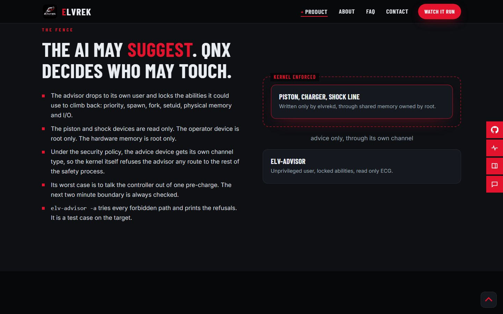 | **Technology.** The AI may suggest. QNX decides who may touch |
| 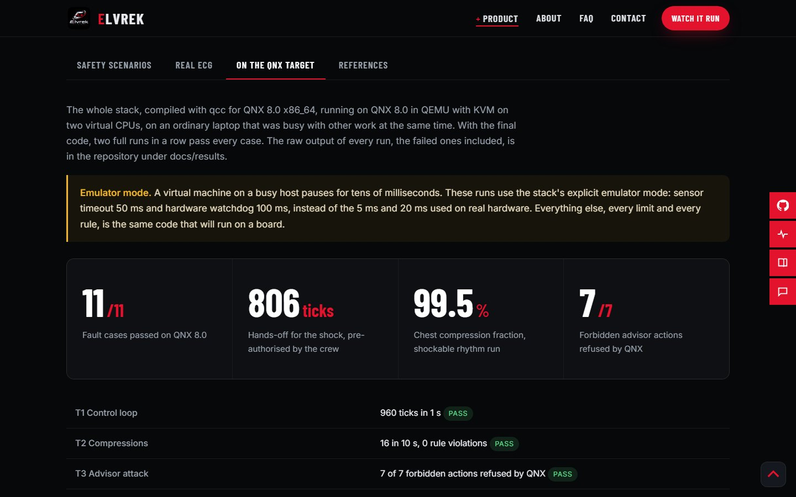 | **Evidence.** Every result on the QNX target, and the honest ECG numbers |
| 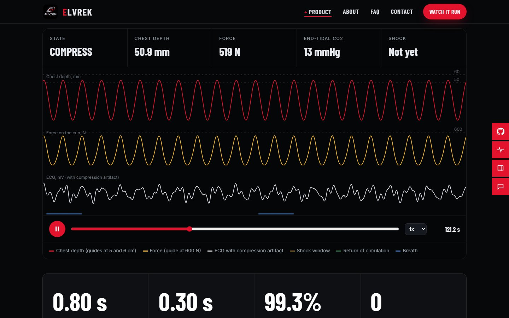 | **Recorded run.** Replay the real controller code through a shock and return of circulation |
| 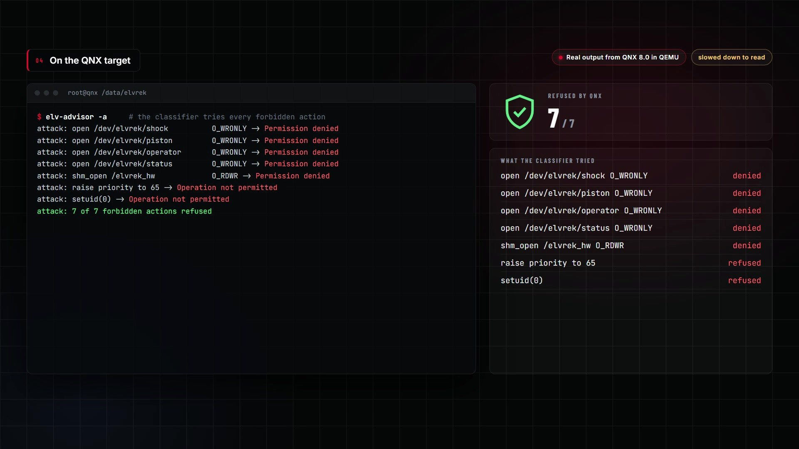 | **On QNX 8.0.** The classifier tries 7 forbidden actions; all 7 are refused |
| 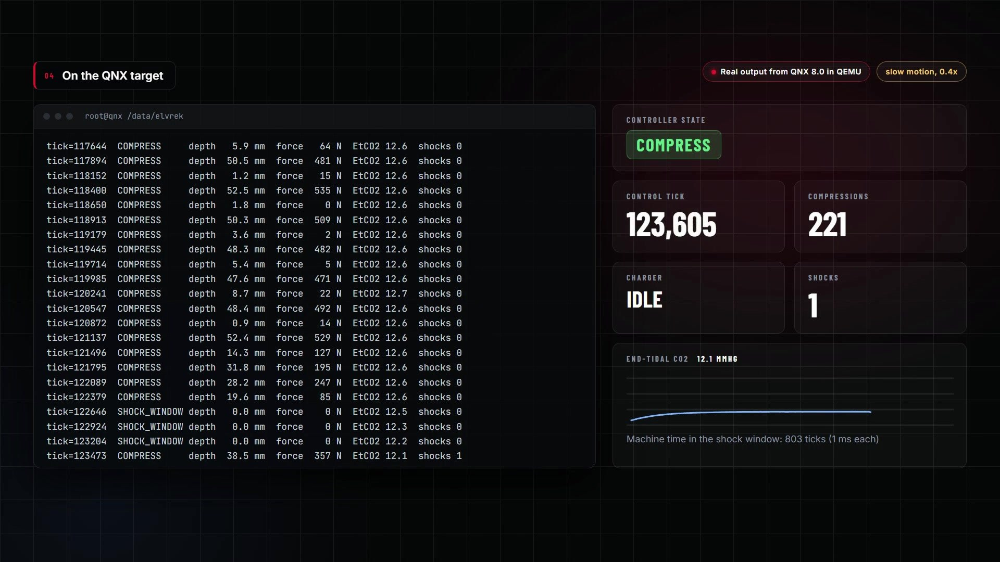 | **On QNX 8.0.** The shock fires on 803 ticks of machine time, then compressions resume |
| 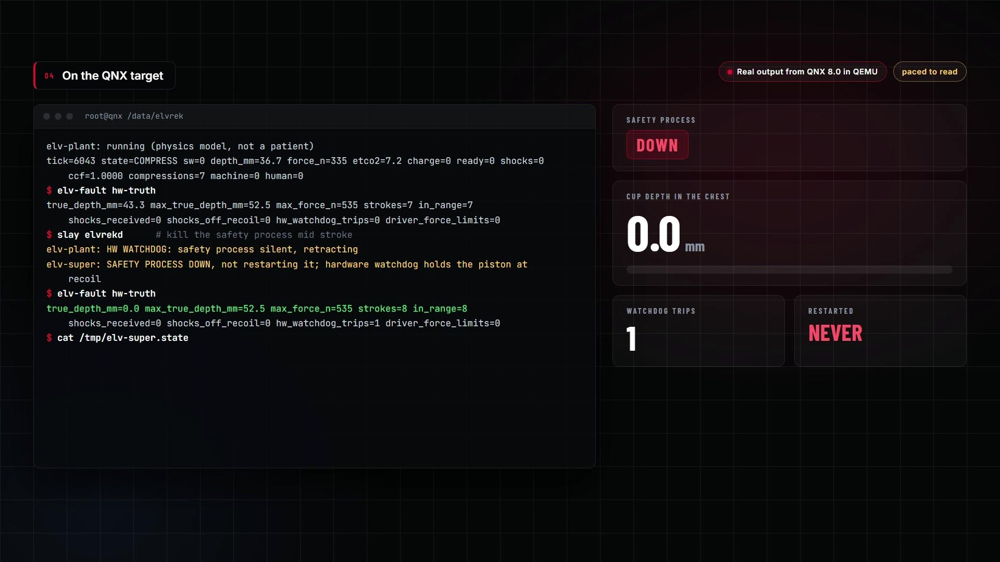 | **On QNX 8.0.** The safety process is killed; the watchdog lifts the cup to 0.0 mm |

<p align="center">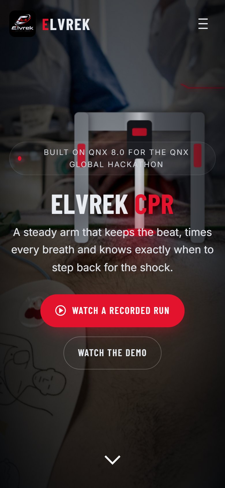</p>

## How it works

### 1. The compression cycle

A smooth stroke at 100 to 120 a minute (110 by default), 5 to 6 cm deep with full recoil at the top. The controller estimates chest stiffness as it pushes and stops early enough to stay under 600 N. If a stiff chest cannot reach 5 cm under that ceiling, the miss is reported, never bought with more force.

### 2. The shock window

About seven seconds before the two minute rhythm check, the charger starts filling while the piston keeps working. At the next full recoil the arm parks, a trusted check reads 0.8 s of clean ECG with no compression artifact in it, and the shock line closes on the crew's press, or straight away if the crew pre-authorised while charging. Compressions restart on the next tick. The window can never stay open longer than 3 s.

### 3. Breaths

Breaths at 10 a minute start only on the upstroke, never against a push. In 30:2 mode the gap is long enough for two breaths and no longer.

### 4. Transport

On a moving ambulance the chest moves under the cup. The motor driver adds its own estimate of that motion to every setpoint, on every driver tick, so a late controller cannot make the depth wrong.

### 5. Return of circulation

A trusted sign, either a pulse input or an abrupt rise in end-tidal carbon dioxide, parks the piston within one compression. The classifier saying so is not enough.

### 6. Faults

Any fault lifts the piston to full recoil at a controlled speed and holds it there. If the safety process stops talking, the driver's own watchdog does the same, and the supervisor never restarts the safety process behind anyone's back.

### 7. Reading the rhythm through the compressions

Every ECG sample taken while the piston cycles goes through an adaptive filter fed with harmonics of the compression phase the controller commands, which removes most of the artifact. Every second the last 3 s are scored by twelve standard rhythm features and a small frozen network trained on CUDB only, a little work on each tick so the 1 ms loop is never late. At the 2-minute check the mean of the last 10 s decides: sure shockable means the arm parks only for the shock pulse; sure not shockable means no pause at all; unsure means the classic 0.8 s look. Method, results and an honest disclosure in [docs/ZERO-PAUSE.md](docs/ZERO-PAUSE.md).

### 8. The rhythm check

Five features on 0.8 s of clean ECG, including the share of power in the 3 to 9 Hz fibrillation band. The thresholds were tuned on one PhysioNet database with a rule fixed in advance, and scored once on another.

## Architecture

```
                QNX 8.0 (QEMU x86_64 today, a Raspberry Pi 5 next)
 +------------------------------------------------------------------------+
 |                                                                        |
 |  elv-advisor  (uid 2002, prio 10)        elv-super  (prio 10)          |
 |  rhythm classifier, untrusted            restarts the advisor,         |
 |        |  advice only                    never the safety process      |
 |        v                                                               |
 |  elv-advice-gate  (type elv_gate_t, uid 2003): /dev/elvrek/advice,      |
 |  the advisor's only door; forwards to the root-only advice_core         |
 |        |                                                               |
 |  elvrekd  (SCHED_FIFO 60, 1 ms timer pulse on a private channel)        |
 |  state machine and independent monitor; owns piston, breaths,          |
 |  charger and shock line; serves /dev/elvrek/status, operator,          |
 |  piston and shock                                                      |
 |        |  setpoints, heartbeat                ^ sensors                |
 |        v                                      |                        |
 |  elv-plant  (SCHED_FIFO 62)  motor driver stand-in: force limit,       |
 |  chest motion correction, hardware watchdog; physics model of the      |
 |  chest, piston, charger, capnograph and ECG                            |
 +------------------------------------------------------------------------+
```

| Process | Priority | Runs as | Job | If it dies |
|---|---|---|---|---|
| `elvrekd` | 60 | root, abilities locked | Owns everything that touches the patient | The driver watchdog lifts the cup; nobody restarts it |
| `elv-plant` | 62 | root | Stands in for the motor driver and sensors | (hardware) |
| `elv-advisor` | 10 | uid 2002, abilities locked | Suggests a rhythm | The supervisor restarts it; compressions continue |
| `elv-advice-gate` | 10 | uid 2003, abilities locked | The advisor's only door to the safety process | SLM restarts it |
| `elv-super` | 10 | root | Watches the advisor and reports on the safety process | Started by SLM |
| `elv-telemetry` | 12 | root | Streams status for a crew screen | Optional |
| `elv-ctl`, `elv-fault` | | root | Crew controls, and fault injection for tests | |

## What the controller guarantees

These rules live in `src/core/elv_core.c` and are checked again, independently, on every tick by `src/core/elv_inv.c`. On QNX a broken rule forces a controlled retract. More in [SAFETY.md](SAFETY.md).

1. The shock line closes only in the shock window, with the piston parked, the rhythm confirmed, the charger full and a press (or a pre-authorisation) from the crew.
2. Force on the chest stays under 650 N; the controller stops pushing at 600 N and backs off.
3. The hands-off window closes within 3 seconds, whatever the crew does.
4. A trusted sign of returning circulation parks the piston within one compression.
5. The classifier alone can never stop compressions, move the piston or close the shock line.
6. Any fault lifts the piston to full recoil at a controlled speed and holds it there. It never stops at the bottom of a stroke.

## Verification

* **Host scenarios** (`make test`): 22 scenarios, including the same VF run with and without reading through the compressions (3 against 803 ticks of hands-off), run the same core code faster than real time against the physics model, including two that stall the controller the way a busy virtual machine does. GitHub Actions runs them on every push.
* **Independent monitor**: six rules checked on every tick by separate code, with 0 violations in every run.
* **On-target fault suite** (`tests/fault_suite.sh`): 11 cases on QNX 8.0, judged on what the chest gets, with the raw output published.
* **Real ECG**: 57 PhysioNet records, tuned on CUDB and scored once on VFDB ([DATA-NOTICE.md](DATA-NOTICE.md)).
* **Every run published**, the failed ones included, with what each one taught us in [RESULTS.md](RESULTS.md).

## Build log

| Date | Milestone |
|---|---|
| 19 Nov 2026 | Safety core, independent monitor, physics model and host scenarios. Website and brand |
| 19 Nov 2026 | Rhythm check tuned and scored on real PhysioNet arrest ECG |
| 19 Nov 2026 | QNX 8.0 image in QEMU, qcc build, the first on-target fault suite runs and the fixes they forced (driver force limit, transport in the driver, catch-up ticks) |
| 19 Nov 2026 | 11 of 11 on QNX 8.0 |
| 20 Nov 2026 | A repeat run uncovered a deeper bug in replayed ticks. Fixed, new stall tests added, then clean runs in a row |
| 20 Nov 2026 | Strict timing runs, the demo film with real QNX output, and the submission |
| 20 Nov 2026 | Writing the codelab showed `ClockPeriod` cannot change the tick on QNX 8.0 in QEMU; the controller now reads it instead, and a third clean run followed |
| 22 Nov 2026 | Security policy recorded with secpolgenerate, tightened and enforced; advice gate process; 12 of 12 with the policy enforced; A/B attack test |
| 21 to 22 Nov 2026 | Reading the rhythm through the compressions: piston-referenced artifact canceller, rhythm model trained on CUDB, spread over control ticks; a lost charge dump found and fixed; 12 of 12 on QNX twice, with 3 ticks of hands-off for the shock |

## Quickstart

**Host tests** (Linux or WSL with gcc):

```sh
make test                                              # 22 safety scenarios
make host-procs                                        # the portable target processes
python3 -I tools/fetch_physionet.py && make ecg-eval   # real ECG evaluation
```

**On QNX 8.0** (QNX SDP 8.0, x86_64 in QEMU, toolchain qcc):

```sh
source ~/qnx800/qnxsdp-env.sh
bash qnx/build.sh                 # builds every target program with qcc (pass aarch64le for a Pi 5)
bash qnx/run-on-qemu.sh           # builds the image with mkqnximage and boots it (once)
EMU=1 bash qnx/suite-only.sh      # copies the programs over and runs the 11 fault cases on the target
```

To set up QEMU and the SDP from scratch, see `tools/setup-qemu.sh` and `tools/install-qnx-sdp.sh` (you type your own myQNX login and licence).

## Repository layout

```
include/        limits, hardware boundary, messages and shared memory layout
src/core/       state machine (elv_core) and the independent monitor (elv_inv)
src/plant/      physics model and motor driver stand-in
src/ecg/        synthetic ECG for the plant
src/advisor/    rhythm classifier
src/qnx/        the QNX processes: elvrekd, elv-plant, elv-advisor, elv-super, elv-ctl, elv-fault, elv-telemetry
qnx/            qcc Makefile, build and image scripts, SLM config, security policy draft
tests/          host scenarios, ECG evaluation, on-target fault suite
tools/          PhysioNet fetcher, QEMU and SDP setup
docs/results/   raw output of every QNX run
video/          the scripts that made the demo film, and the real QNX output it replays
media/          screenshots used in this README
codelab/        a QNX 8.0 codelab with its own runnable example
web/            the website, deployed on Vercel
```

## Documentation

| Document | What it covers |
|---|---|
| [SUBMISSION.md](SUBMISSION.md) | Every hackathon submission field in one place |
| [QNX.md](QNX.md) | Exactly how and where QNX 8.0 is used, file by file |
| [SAFETY.md](SAFETY.md) | The safety rules, the monitor, and what the controller will never do |
| [RESULTS.md](RESULTS.md) | Every run on QNX, what failed and what it taught us |
| [docs/TIMING.md](docs/TIMING.md) | Timing from a QNX kernel trace, and what a virtual machine cannot prove |
| [video/README.md](video/README.md) | How the demo film was made |
| [Codelab: a 1 ms control loop that fails safe](codelab/fail-safe-control-loop/fail-safe-control-loop.md) | A step by step QNX 8.0 tutorial built from what Elvrek taught us, with runnable code. Submitted to the official QNX codelabs as [pull request 81](https://github.com/qnx/codelabs/pull/81) |
| [qnx/secpol/README.md](qnx/secpol/README.md) | The enforced security policy: how it was recorded and tightened, the advice gate, and the A/B attack results |
| [DATA-NOTICE.md](DATA-NOTICE.md) | PhysioNet data and photo credits |

## Risks and limits

* **Not a medical device.** No clinical claim is made, and it must never touch a person.
* **Physics model, not hardware.** The piston and chest are modelled. The next step is a Raspberry Pi 5, a linear actuator, a load cell, a recoil switch, a mechanical stop and a lamp instead of a shock, on a training manikin only.
* **Rhythm check.** On held-out real ECG it does not yet meet clinical goals (VF above 90%, sinus above 99%, asystole above 95%), so the 0.8 s step is a careful timed pause, not a diagnosis.
* **Timing in a virtual machine.** The 11 of 11 runs use the labelled emulator mode. At real hardware timings, a nested VM passes 9 of 11.
* **Security policy.** Enforced on the QNX image. A classifier that somehow stayed root under its type could still open the hardware shared memory, which this policy does not govern; the real classifier drops root first, which closes it ([details](qnx/secpol/README.md)).
* **Performance results.** Timing is reported in control ticks and PASS or FAIL, not microseconds, while the QNX Everywhere licence question about publishing performance results is open.

## Data and licence

Code: Apache License 2.0 ([LICENSE](LICENSE)). ECG data comes from PhysioNet (CUDB and VFDB) under the Open Data Commons Attribution License, and is downloaded by the script rather than stored here. Photos on the website are used under the Unsplash License. The demo film's music is original. See [DATA-NOTICE.md](DATA-NOTICE.md).
