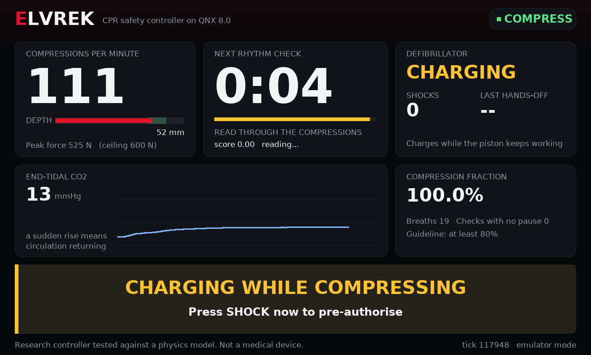

# Crew console on QNX Screen

A machine that does the compressions changes what the crew needs to see. They no longer count, time or press for every pause. They need to know four things at a glance: is it compressing well, when is the next rhythm check, is the defibrillator charging, and is circulation coming back. `elv-console` is that screen. It runs on the QNX target and draws with QNX Screen.



## What it shows

| Card | What it says | Where it comes from |
|---|---|---|
| Compressions per minute, depth, peak force | rate timed stroke to stroke over the last 8 strokes on the controller's clock; the deepest point and highest force of the last second, against the 5 to 6 cm band and the 600 N ceiling | `compressions`, `tick`, `pos_mm`, `force_n` |
| Next rhythm check | countdown to the 2-minute check, and what the reading through the compressions says right now: sure shockable, sure not shockable, or not sure (the 0.8 s look will run) | `next_check`, `zp_score` |
| Defibrillator | idle, charging, ready or discharge; shocks given; the last hands-off time, in 1 ms ticks | `charge`, `ready`, `shocks`, `max_machine` |
| End-tidal CO2 | value and a 2-minute trend. A sudden rise is the classic sign of circulation returning | `etco2` |
| Compression fraction | share of time with compressions, breaths given, checks that needed no pause at all | `ccf`, `breaths`, `zp_skipped` |
| Banner | one line for the crew: compressing, charging while compressing (press SHOCK to pre-authorise), shock delivered, no pause needed, return of circulation, safe hold with the fault | `state`, `sw`, `fault` |

## How it is built

* **Read only.** The console opens `/dev/elvrek/status` ten times a second and nothing else. It has no path to the piston, the charger or the shock line. If it hangs or dies, the safety process does not notice. It runs at a low priority.
* **Drawing apart from display.** [`src/console/elv_console_draw.c`](../src/console/elv_console_draw.c) draws a frame into a plain pixel buffer, with a DejaVu font turned into C arrays at build time ([`tools/make_font.py`](../tools/make_font.py)). [`src/qnx/elv_console.c`](../src/qnx/elv_console.c) is the QNX side: a Screen context, a 1280 by 768 window with two buffers, `screen_post_window` every frame.
* **What the first runs taught us.** The first screen showed depth as wherever the piston was when the status was read, so it could say 4 mm halfway up a good 52 mm stroke. It now shows the deepest point of the last second. It counted strokes in a 3 s window, which reads a steady 110 per minute as 100 or 120; it now times strokes, and reads 109 to 112, within about 2%, since a stroke is only seen at the next 10 Hz read. And it carried the EtCO2 trend of one rescue into the next; it now starts fresh when the controller restarts.
* **Same numbers everywhere.** Whole numbers are rounded by our own code, not by `printf`. The first run showed why: QNX's C library prints 8.5 as 9 and glibc prints it as 8, so the same reading came out as two different EtCO2 values on two systems.
* **Screen on the emulator.** The QEMU image has no display, so Screen runs with its virtual display configuration (`graphics-virtual-display.conf`, software blitting), copied from the SDP to `/data/screen` on the target and started by hand. On a board with a display the same binary draws to the panel.

## How we know the pictures are real

A virtual display cannot be filmed, and the target has about 50 MB free, not enough for a video's worth of full frames. So the console records two things while it runs ([`tests/console_run.sh`](../tests/console_run.sh)):

1. every status line it drew, with its time (`-l`), which is small;
2. a full frame copied out of the Screen window buffer every 30 s (`-o`, `-e 300`).

On the host, `console_replay` feeds the recorded lines through the same drawing code, frame by frame. Each frame saved from Screen on the target is then compared with the replay, pixel by pixel: **11 of 11 frames identical, 0 of 2,949,120 values different**. The video and the pictures on this page are made from that replay, and the check shows the replay matches what QNX Screen drew. Log and check output: [`docs/results/qnx-console-run.txt`](results/qnx-console-run.txt).

## The run

QNX 8.0 in QEMU, emulator mode, two idle keep-awake threads at priority 1 (as in the fault suite). Two rescues back to back, with the console drawing throughout:

| | What happened | What the crew saw |
|---|---|---|
| A, VF | charger filled during compressions, crew pre-authorised, the rhythm read through compressions was sure shockable, shock with **3 ticks** hands-off, compressions resumed, EtCO2 jumped and the piston parked | COMPRESSING, CHARGING WHILE COMPRESSING, SHOCK DELIVERED, RETURN OF CIRCULATION. The shock window itself lasted 3 ms, so at ten frames a second the screen never shows it: there is no pause to show |
| B, sinus, no advisor | at the 2-minute check the reading was sure not shockable, so there was no pause at all | NO PAUSE NEEDED |

## Does the console disturb the 1 ms loop?

Same guest, 60 s of compressions each, alternating ([`tests/console_ab.sh`](../tests/console_ab.sh), output in [`docs/results/qnx-console-ab.txt`](results/qnx-console-ab.txt)):

| Console | Missed ticks, run 1 | Missed ticks, run 2 |
|---|---|---|
| off | 8,415 | 2,410 |
| on, drawing at 10 Hz | 2,684 | 3,274 |

Missed ticks on this machine come from the host parking virtual CPUs (see [TIMING.md](TIMING.md)), and they swing between runs more than the console could move them. On this emulator there is no effect we can see. The real check is a kernel trace on hardware, with the console running.

## Run it

```sh
# target: Screen running from /data/screen, binaries in /data/elvrek/bin
EMU=1 sh /data/elvrek/console_run.sh
# host
make console                                   # preview six states, build the replay tool
./build/console_replay build/con/log.txt -c build/con/frame-00004.ppm 1200
python video/console_video.py build/con/log.txt video/capture/console.mp4
```
